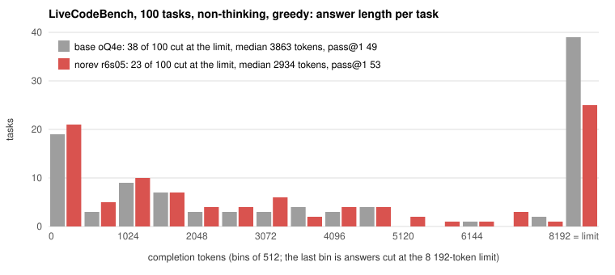

# flash-next-norev

**Removing the "self-revision" subspace from Qwen3.8-Flash-Next without training: 40 % fewer answers cut at the token limit and a
quarter shorter answers at unchanged accuracy (LiveCodeBench 51 → 53 without thinking, 63 → 69 with thinking, both within noise).**

**Ready-to-run model (118 GB, oMLX on a 128 GB Mac):
[huggingface.co/blazkepa/Qwen3.8-Flash-Next-norev-oQ4e-MTP](https://huggingface.co/blazkepa/Qwen3.8-Flash-Next-norev-oQ4e-MTP).**
This repository has the code, the measured directions and every per-task result behind it.

> Status: work in progress (November 2026). The greedy, the sampled (3 × 2 runs, plus 2 × 2 with Qwen's presence penalty) and the thinking-mode results below are measured.
> Nothing here is a product; it is a documented experiment with its failures included.
>
> Corrections, 2026-11-09. (1) Earlier versions claimed "−40 % wall time". The timings were real but did not isolate the edit, see
> "A note on wall time" below; the tables now report tokens. (2) The greedy base score was reported as 49: two of its 100 requests had
> been rejected by the server's memory guard and counted as failures. They are regenerated now (`--retry-from`), the base is 51 and the
> paired result is +6 / −4 instead of +8 / −4. (3) Several descriptions were tightened after an independent re-check of every number
> against the result files (number of answers used for the measurement, sampling settings versus Qwen's recommendation, disk usage).

## The problem

Qwen3.8-Flash-Next (125 B MoE, 6 B active) tends to solve a coding task, then write "Wait, let me reconsider…" and start over,
sometimes several times, until it hits the token limit. It happens in both modes. On a 100-task LiveCodeBench subset, **38 of 100
non-thinking answers hit the 8 192-token limit** on the base model, and 12 of those 38 tasks are solved by the edited model or by a
sampled non-thinking run of the base itself (16 counting the base's thinking-mode run), i.e. the spiral blocks answers that are within
reach. With thinking on and a 32 768-token limit, 33 of the base's 37 failures are answers cut at the limit, not wrong answers; the
thinking text was not kept, so there the loop is inferred from the counts (the edit cuts these 33 to 28 and the median answer from
18 k to 10.5 k tokens), not read from the answers.

## The method

1. **Measure a direction.** Run the base model over 160 earlier Flash-Next answers to open-r1 coding problems (non-thinking, generated
   by the oQ5e build of the same model) and record the residual stream at revision phrases ("Wait", "Actually", "Hmm, let me re-check";
   the first token of the phrase and one neighbouring token, see `tools/README.md`) versus the same number of sentence starts without a
   revision, 3 020 positions each.
   Difference of means gives one direction per layer and per residual stream. Flash-Next has **4 hyper-connection residual streams**; the
   directions must be measured in the *raw* streams, before the mixer, or the edit does nothing (trap no. 1).
2. **Reduce.** The per-stream directions are not parallel (cosine 0.03–0.47 between streams at layer 32), but they lie in a
   low-dimensional subspace: **6 PCA components** capture 84 % of their energy in layers 5–44 (`directions_pca6.npz`).
3. **Edit the weights.** For every matrix that writes into the residual stream (149 tensors: attention output projections, GatedDeltaNet
   output projections, expert and shared-expert `down_proj`, PLE value projection, embeddings):
   `W' = W − s · U (Uᵀ W)` with `U` the 6 directions and `s = 0.5`.
   The model is 4-bit quantised; the edit happens in the dequantised domain and the tensor is re-quantised with fresh scales.
   With 4-bit experts the rounding gives back ~30 % of the removed component (trap no. 2), so expert `down_proj` are re-quantised to **6 bit**
   (+10 GB). Full scale `s = 1.0` over-corrects and loses accuracy (trap no. 3); `s = 0.5` was the best of the variants tried (rank 1, rank 3,
   rank 6 at scale 1.0 and 0.5), with the differences between them inside the noise.
4. No gradient step anywhere. The whole edit, re-writing the shards included, takes about 40 s on an M5 Max.

## Results

LiveCodeBench, fixed 100-task subset (23 easy / 31 medium / 46 hard, contests 2025-02-15 … 2025-04-06, see
`eval/livecodebench/subset_ids.json`), non-thinking mode, greedy decoding, 8 192 output tokens, pass@1 with full hidden tests:

| model (all oQ4e WLSRefit MTP, same machine) | pass@1 | hard | hit token limit | median tokens | total tokens |
|---|---|---|---|---|---|
| base | 51 / 100 | 8 / 46 | 38 | 3 863 | 445 k |
| norev, 6 dirs, scale 1.0 (`pca6`) | 43 / 100 | | | | |
| **norev, 6 dirs, scale 0.5 (`r6s05`)** | **53 / 100** | **12 / 46** | **23** | **2 935** | **373 k** |

Paired on tasks: r6s05 gains 6, loses 4 (sign test p = 0.75; 5 of the 6 gains are tasks the base truncated). On 100 open-r1 problems
that were not used for measuring the direction (the same set that was used to pick the variant; greedy, 3 500 tokens, in-process):
base 68, r6s05 66, median answer length −32 %.



What changed is how often the model argues with itself. On those 100 open-r1 problems, counting "Wait", "But wait", "Actually", "Hmm",
"Alternatively" and "Let me reconsider / re-check / re-think" per answer: 4.6 → 1.3 revision phrases per answer; answers with at least
one revision 65 → 39; with three or more 48 → 16; answers cut at the token limit 28 → 15. Not zero on purpose: at full scale the
revisions almost vanish (4.5 → 0.2 per answer, measured through oMLX) and the accuracy drops (LiveCodeBench 43 vs 51); the reading
that some of those revisions were genuine self-correction is an interpretation, not a measurement.

Noise: on 100 tasks a ±5 difference is within run-to-run noise for sampled decoding and within perturbation noise even for greedy
(the rank-1 variant moved −6 while barely changing the behaviour: revisions 4.6 → 4.8 per answer, truncations 28 → 30). Treat the pass@1 delta as "not worse" and the
token delta (which is large and consistent on both sets) as the real effect.

**Sampled decoding** (temperature 0.7, top_p 0.8, top_k 20; 3 samples per model, same subset, 8 192 tokens; aggregated with
`summarize_samples.py`). These are Qwen's recommended non-thinking settings without the presence penalty; the runs with it follow below.

| model | pass@1, mean ± population sd | samples | hard (mean) | hit token limit (of 300) | median tokens | total tokens (3 samples) |
|---|---|---|---|---|---|---|
| base | 50.7 ± 3.4 | 54, 46, 52 | 9.0 / 46 | 110 | 4 265 | 1.35 M |
| **r6s05** | **52.0 ± 1.4** | 54, 51, 51 | 10.7 / 46 | **68** | **2 256** | **1.05 M** |

Paired on tasks (per-task pass fractions): r6s05 better on 17, base better on 16, tie on 67; sign test p = 1.0. Tasks passed in all
three samples: 38 (r6s05) vs 40 (base). With sampling the accuracy is the same within noise, while the edited model hits the token
limit 38 % less often and its median answer is about half as long (22 % fewer tokens in total). 13 tasks of the second r6s05 sample failed with API errors
(the server was under memory pressure from unrelated load) and were regenerated afterwards with the same settings (`--retry-from`).

**With Qwen's recommended presence penalty**, i.e. the same plus `presence_penalty=1.5` (2 samples per model, `-pp15-s1` and
`-pp15-s2`). Note that oMLX (via mlx-lm's `make_presence_penalty`, default `context_size=20`) applies it only to tokens seen in the
last 20 positions, and the window cannot be changed per request; Qwen's recommendation assumes the OpenAI/vLLM definition, which
counts every generated token. So this is a much weaker penalty than the one Qwen means:

| model | pass@1, mean ± population sd | samples | hard (mean) | hit token limit (of 200) | median tokens | total tokens (2 samples) |
|---|---|---|---|---|---|---|
| base | 50.5 ± 1.5 | 49, 52 | 9.0 / 46 | 69 | 5 196 | 929 k |
| **r6s05** | **55.5 ± 4.5** | 60, 51 | 14.5 / 46 | **43** | **2 940** | **730 k** |

Paired on tasks: r6s05 better on 17, base better on 8, tie on 75 (sign test p = 0.11); passed in both samples: 46 vs 43. The samples
are independent, so pairing them is arbitrary; r6s05's first sample (60) is the outlier: against the two base samples it is +16 / −5
(p = 0.027) and +14 / −6 on tasks, its second sample (51) is +7 / −5 and +7 / −8. I read the 60 as a lucky draw and the accuracy as
unchanged. Two things the penalty did show: the 20-token penalty does not cure the base's loops (35 % of its answers still hit the
limit, vs 37 % without the penalty, same pass rate), which is expected since a restart a few hundred tokens later is outside its
window (I did not test a full-history penalty); and it makes the answers of both models somewhat longer (median base 4 265 → 5 196,
r6s05 2 256 → 2 940 tokens; totals +3 % and +4 %) without changing the base-vs-edit comparison (−21 % tokens with it, −22 % without).
Before trusting the comparison I checked that the penalty takes effect in both oMLX serving paths (the base runs resident and
single-stream, r6s05 batched with the n-gram table on SSD): for each model, the greedy output with the penalty departs from the
no-penalty output at the same place whether the request runs alone or alongside three others (3 of 4 test prompts; the fourth differs
because greedy decoding here is not bit-exact between runs). The probe is `eval/livecodebench/presence_penalty_probe.py`.

**Thinking mode** (temperature 0.6, top_p 0.95, top_k 20; Qwen recommends temperature 1.0 for thinking, these runs used 0.6;
32 768 output tokens, same subset, one run per model):

| model | pass@1 | easy / medium / hard | hit token limit | median tokens | total tokens |
|---|---|---|---|---|---|
| base | 63 / 100 | 23 / 25 / 15 | 33 | 18 027 | 1.71 M |
| **r6s05** | **69 / 100** | **23 / 28 / 18** | **28** | **10 533** | **1.47 M** |

Paired on tasks: r6s05 gains 7, loses 1 (sign test p = 0.07); 6 of the 7 gains are tasks the base truncated. One sampled run per
model, so the ±4 run-to-run noise measured above applies here as well. Thinking helps both models (+12 and +16 over greedy
non-thinking), and the revision loop remains the dominant failure: 33 of the base's 37 failures and 28 of r6s05's 31 are answers cut at
32 768 tokens rather than wrong answers. Per-task results: `eval/livecodebench/results/*-think-32k-t06.json`.

**Is the edit local?** Three benchmarks the edit does not target, same machine, greedy, non-thinking, 4 streams:

| benchmark | base | r6s05 | paired (+ / −) | median tokens | at token limit |
|---|---|---|---|---|---|
| HumanEval, 164 tasks, 4 096 tokens | 156 (95.1 %) | 157 (95.7 %) | +2 / −1 | 160 → 164 | 0 → 1 |
| GSM8K, fixed 300-problem subset of test, 2 048 tokens | 292 (97.3 %) | 293 (97.7 %) | +2 / −1 | 336 → 324 | 1 → 1 |
| MMLU, 570 questions (10 per subject), zero-shot, one letter | 500 (87.7 %) | 500 (87.7 %) | +4 / −4 | 1 → 1 | 0 → 0 |

The MTP (multi-token prediction) draft head is edited like the rest of the model (3 of the 149 tensors), and its acceptance does not
drop: on identical prompts through oMLX, single stream, the draft acceptance is 89.1 % (base) vs 90.6 % (r6s05), with 3.3 vs 3.1 tokens
per backbone pass. Warm decode speed is 91–100 tok/s (base) vs 96–107 tok/s (r6s05) on 3 prompts; the first, cold pass of r6s05 was
74–82 tok/s, probably because its n-gram table was still being paged in from SSD (`tools/omlx_bench_tps.py`).

**A note on wall time.** Earlier versions of this README reported wall-clock times (123 → 73 min greedy, 119 → 78 min per sampled run)
and a "−40 % wall time" headline. The thinking-mode pair (587 → 294 min for 14 % fewer tokens) made it obvious that those timings do not
isolate the edit. On this 128 GB machine oMLX loads the base fully resident (100.5 GiB as its log reports it) and, according to its log, then serves the four
benchmark streams mostly one at a time through the single-stream MTP path; r6s05 is 10 GB larger, does not fit resident, gets its
n-gram table memory-mapped from SSD (80 GiB resident) and is served as a batch of four. Total throughput was 49–66 tok/s in the base
runs and 67–86 tok/s in the r6s05 runs. The timings therefore mix the server mode with the model, the two cannot be separated from
these runs, and the timings are no longer reported. The comparable quantity is the token count: −16 % total tokens greedy, −22 % sampled, −14 % with thinking. The base has not
been re-run in the SSD mode yet.

Nothing moves beyond one or two tasks. HumanEval and GSM8K are also a useful negative control for the mechanism: the base model almost never
hits the token limit there (0 / 164 and 1 / 300), i.e. the revision spiral only appears on hard, long tasks, which is exactly where the
edit helps on LiveCodeBench. Runners, data subsets (with fixed seeds) and per-task results are in `eval/humaneval`, `eval/gsm8k`, `eval/mmlu`.

**Reference point: an expert-pruned variant.** The other way to make this model cheaper is to drop experts. For scale we ran the same
four benchmarks, same harness and settings, on `sh0wie/Qwen3.8-Flash-Next-REAP-288-MLX-4bit` (288 of 512 experts kept by REAP saliency,
4-bit, ~69 GiB resident vs ~100 GiB, no MTP head):

| benchmark (greedy, non-thinking) | base oQ4e | r6s05 (this work) | REAP-288 | REAP vs base, paired |
|---|---|---|---|---|
| LiveCodeBench 100, 8 192 tokens | 51 | **53** | 45 | +3 / −9 |
| … hit token limit / median tokens | 38 / 3 863 | **23 / 2 935** | 46 / 6 610 | |
| HumanEval 164 | 156 | **157** | 151 | +3 / −8 |
| GSM8K 300 | 292 | **293** | 286 | +4 / −10 |
| MMLU 570 | 500 | 500 | 293 | +15 / −222 |

Pruning buys memory and nothing else here: it does not touch the revision spiral (the pruned model hits the token limit *more* often
and its median answer is 70 % longer than the base's, total tokens +10 %), costs 4–6 tasks on LiveCodeBench, HumanEval and GSM8K, and
almost halves MMLU (50 of its 570 answers ignored the
"letter only" instruction and started reasoning; even counting only answered questions it is at 56 %, and the losses are broad, largest in college-level
science and medicine). The two approaches are orthogonal and could be combined; we did not, because the memory saving is not what we
were after. Per-task results: `eval/*/results/flash-reap288-*.json`.

### What did not work (kept on purpose)

| attempt | result | why it is here |
|---|---|---|
| mean-direction edit after the stream mixer | no behavioural change | directions must be measured in raw streams |
| 4-bit experts after the edit | about 30 % of the removed component comes back (from the lab notes; that variant's report was not kept) | quantisation step is larger than the edit |
| 6 dirs, scale 1.0 | LCB 43 (−8), held-out 58 vs 60 (both through oMLX) | too strong; revisions almost vanish (4.5 → 0.2 per answer) but more answers are short and wrong |
| rank 1 / rank 3 | held-out 62 / 63, tokens −8 % / −29 % | rank 3 already shortens, rank 6 at half scale is better |
| fewer active experts for speed (`num_experts_per_tok` 10 → 8 / 6 / 4, no weight change) | single-stream decode 41.7 → 44.8 / 45.7 / 46.8 tok/s (+7 / +10 / +12 %) | experts are ≤ 20 % of per-token time on this hardware; not worth the quality risk, quality not measured (`tools/flash_bench_tps.py`) |

## Repository layout

```
tools/flash_find_direction.py    measure per-layer, per-stream revision directions (mlx_vlm, in-process)
tools/flash_check_direction.py   mechanical check: separation along the direction, base vs edited
tools/flash_ablate.py            apply the edit to an oMLX model directory (writes a new model directory)
tools/flash_ab_generate.py       in-process A/B generation + grading on held-out problems
tools/flash_bench_tps.py         in-process single-stream decode throughput of a model view (same prompts for every variant)
tools/omlx_bench_tps.py          the same through oMLX with MTP speculative decoding on; also collects the MTP acceptance oMLX logs
tools/d1_*.py                    shared helpers (revision regex, open-r1 loader, prompt)
train/edits/flash_revision_raw/  measured directions (48 layers × 4 streams), PCA-6 file, measurement report
train/edits/flash_revision/      lab notes (NOTES.md in English, NOTES.pl.md the Polish original)
eval/common/llm.py               minimal OpenAI-compatible client (stdlib only)
eval/livecodebench/              subset builder, runner, 3-sample aggregator, chart script, results as JSON (one entry per task, code included)
eval/humaneval/                  HumanEval runner (executes tests in a sandboxed subprocess), data, results for base and r6s05
eval/gsm8k/                      GSM8K runner, fixed 300-problem subset of the test split (seed 7), results
eval/mmlu/                       MMLU runner (zero-shot, letter answer), 570-question subset (10 per subject, seed 7), results
```

## Reproducing the model

To just use it, download the finished model from
[Hugging Face](https://huggingface.co/blazkepa/Qwen3.8-Flash-Next-norev-oQ4e-MTP); this section is for rebuilding it yourself.

Requirements: Apple Silicon with ≥ 128 GB unified memory, [oMLX](https://github.com/jundot/omlx) (everything here was run with the
0.7.4.dev1 macOS app), `mlx`, `mlx_vlm`, `numpy`, and the base model `GBP-DE/Qwen3.8-Flash-Next-oQ4e-WLSRefit-MTP` **at revision
`8a284d64`** (2026-11-01) in `~/.omlx/models/GBP-DE/`. GBP-DE has updated that repository in place since then; the current `main` is a
different build and nothing here was measured on it:

```bash
hf download GBP-DE/Qwen3.8-Flash-Next-oQ4e-WLSRefit-MTP --revision 8a284d6420a6b7d30e8a238a23b8980d6978509e \
    --local-dir ~/.omlx/models/GBP-DE/Qwen3.8-Flash-Next-oQ4e-WLSRefit-MTP
```

```bash
python -I tools/flash_ablate.py \
    --model-dir ~/.omlx/models/GBP-DE/Qwen3.8-Flash-Next-oQ4e-WLSRefit-MTP \
    --dirs train/edits/flash_revision_raw/directions_pca6.npz --dir-layer 1 --streams all \
    --expert-bits 6 --scale 0.5 \
    --out ~/.omlx/models/local/Qwen3.8-Flash-Next-oQ4e-WLSRefit-MTP-norev-r6s05
```

Shards without edited tensors (the 5 n-gram table shards, 25 GB) are hard-linked; the other 16 are rewritten, so the new directory
needs about 93 GB of free disk, and the model is 10 GB larger than the base (the 6-bit experts). `ablation.json` in the output
records every edited tensor and the mean relative change (0.025 for r6s05). Restart oMLX to see the model.

Re-measuring the directions from scratch (`flash_find_direction.py`) needs a few hundred model answers to open-r1 problems; the 160
used here (generated by the oQ5e build) will be added to the repository.

## Reproducing the evaluation

```bash
python -I eval/livecodebench/make_subset.py          # downloads livecodebench/code_generation_lite, builds the same 100-task subset (sha256 in subset_ids.json)
python -I eval/livecodebench/run_livecodebench.py --model <oMLX model id> --no-think --max-tokens 8192 --workers 4 --tag <tag>
python -I eval/livecodebench/run_livecodebench.py ... --temperature 0.7 --top-p 0.8 --top-k 20 --tag <tag>-s1   # sampled runs
python -I eval/livecodebench/summarize_samples.py <tagA> <tagB>                                                  # mean ± population sd, paired sign test
```

The runner talks to any OpenAI-compatible server (`LLM_BASE_URL`, `LLM_API_KEY`); hidden tests are executed in a subprocess with a
10 s / 1 GB limit per test.

## How to use this on your own model

There are two levels of reuse. The first needs no measurement; the second needs the model's own answers and a few hours.

### A. Apply the published directions to your copy of Flash-Next

Works for any oMLX / mlx_vlm checkpoint of **Qwen3.8-Flash-Next** (`model_type: qwen4_exp`) stored as safetensors with affine
quantisation (`weight` / `scales` / `biases`, group size 64, 4 or 8 bit): the GBP-DE oQ4e and oQ5e builds, the orcarouter
*Uncensored* build, or your own oQ conversion. The directions live in the residual-stream space (2 560 dims), so they may transfer
across quantisations of the same weights; this is untested. Only the oQ4e WLSRefit build at revision `8a284d64` is measured.

```bash
pip install mlx numpy                      # the edit script needs only these (no mlx_vlm)
python -I tools/flash_ablate.py \
    --model-dir <path to your Flash-Next model dir> \
    --dirs train/edits/flash_revision_raw/directions_pca6.npz --dir-layer 1 --streams all \
    --expert-bits 6 --scale 0.5 \
    --out <new model dir, e.g. ~/.omlx/models/local/<name>-norev>
```

It processes one shard at a time (about 40 s in total on an M5 Max) and hard-links the shards it does not touch. Knobs:
`--scale` (0.5 was the best of the variants tried; 1.0 over-corrects), `--rank k` (use only the first *k* of the 6 directions; 1 and 3 are weaker),
`--expert-bits 4` (keeps the model ~10 GB smaller but about 30 % of the edit is lost to rounding), `--no-embed` (leave the embedding
table alone). Restart oMLX; the new directory shows up as a model. Compare base and edit with the same prompts before trusting it.

### B. Measure a direction yourself (other behaviour, other checkpoint)

What you need:

1. **The model's own answers** as JSONL, one row per answer, fields `id`, `text` (the full response), `truncated` (bool) and
   `passed` (bool). `tools/d1_sample.py` produces this format from open-r1 coding problems through any OpenAI-compatible endpoint;
   any other source works if it has those four fields. Around 150–300 answers that contain the behaviour are enough.
2. **The phrase regex** that marks the behaviour: `REV` in `tools/d1_find_direction.py` ("Wait", "Actually", "Hmm", "Let me
   reconsider", …). Replace it to target something else (hedging, apologising, switching language, …). The method only needs a
   set of positions where the behaviour *starts*; everything else is difference of means.
3. **A machine that holds the model in memory**: `flash_find_direction.py` and `flash_check_direction.py` run the model
   in-process with mlx_vlm (≈75 GB resident for the 4-bit Flash-Next, 16 min for 160 answers on an M5 Max).

Pipeline:

```bash
python -I tools/flash_find_direction.py --model <model dir> --samples <answers.jsonl> --raw --limit 160 --trunc-frac 0.75 --out <dir>   # directions.npz + report.json
python -I tools/flash_check_direction.py --model <model dir> --dirs <dir>/directions.npz --samples <answers.jsonl> --layers 1,16,24,32   # separation (Cohen's d, AUC) along d, base
python -I tools/flash_ablate.py --model-dir <model dir> --dirs <dir>/directions.npz --dir-layer 1 --streams all --expert-bits 6 --scale 0.5 --out <new dir>
python -I tools/flash_check_direction.py --model <new dir> --dirs <dir>/directions.npz --samples <answers.jsonl> --layers 1,16,24,32     # separation should collapse towards 0
```

Then measure on a benchmark you trust, base vs edit, same settings, ≥ 100 tasks. For reducing the per-stream directions to a few PCA
components (the `directions_pca6.npz` step) see `train/edits/flash_revision/NOTES.md`.

### Compatibility

| | supported | notes |
|---|---|---|
| Qwen3.8-Flash-Next, oMLX / mlx_vlm safetensors (oQ4e, oQ5e, oQ8, Uncensored builds) | oQ4e WLSRefit measured; the others should run, untested | the tensor list in `flash_ablate.py` (`PAT`) and the raw-stream hooks in `flash_find_direction.py` are written for `qwen4_exp` |
| Other Qwen3.x MoE / dense checkpoints in MLX | with changes | adapt `PAT` to the tensor names that write into the residual stream, and the hook that reads the stream; single-stream models are simpler (no hyper-connection mixer, `--streams mean`) |
| GGUF, AWQ, GPTQ, PyTorch/HF safetensors | no | the quantisation handling is MLX affine only; convert to MLX first or port the dequantise → project → requantise loop |
| Non-Apple hardware | no (as is) | `mlx` is Apple-Silicon only; the maths is 30 lines of numpy and ports easily, the model loading does not |

Tested with mlx 0.32.4, mlx_vlm 0.7.11, numpy 2.5.4, oMLX 0.7.4.dev1, macOS 26.

## Limitations

- One machine (MacBook Pro, M5 Max, 128 GB), one quantisation, one subset of 100 tasks. Numbers are for *this* checkpoint; the directions were
  measured on it and may or may not transfer to other quantisations of the same weights (untested).
- Thinking mode: one sampled run per model (32 k budget, temperature 0.6 where Qwen recommends 1.0); no repeated samples yet.
- Non-thinking: 3 sampled runs per model without and 2 with `presence_penalty=1.5` as oMLX implements it (last 20 tokens only); it did
  not change the base-vs-edit comparison. A full-history penalty as in vLLM is untested.
- No controlled wall-clock comparison (see "A note on wall time"); only token counts are comparable between base and edit.
- General capability checked on subsets only (300 GSM8K problems, 570 MMLU questions, full HumanEval), greedy and non-thinking; no
  full MMLU, no multilingual or long-context tests.
- Refusals: a handful of prompts checked by hand, no difference noticed; not measured systematically.

## Lineage and licenses

- `Qwen/Qwen3.8-Flash-Next` (Qwen Community License 1.0) → `GBP-DE/Qwen3.8-Flash-Next-oQ4e-WLSRefit-MTP` (oQ4e importance-aware
  quantisation, WLS refit, MTP head; 2026-11-01 rebuild with oMLX 0.7.3) → this edit.
- Code, direction files and results in this repository: MIT. Model weights are not in this repository.
- The write-into-stream tensor list follows the abliteration recipe published by *orcarouter* for this architecture; the measured
  direction, the PCA reduction, the raw-stream measurement and the quantisation handling are new.

## Author

[github.com/blazkepa](https://github.com/blazkepa) · [huggingface.co/blazkepa](https://huggingface.co/blazkepa) · model:
[blazkepa/Qwen3.8-Flash-Next-norev-oQ4e-MTP](https://huggingface.co/blazkepa/Qwen3.8-Flash-Next-norev-oQ4e-MTP)
